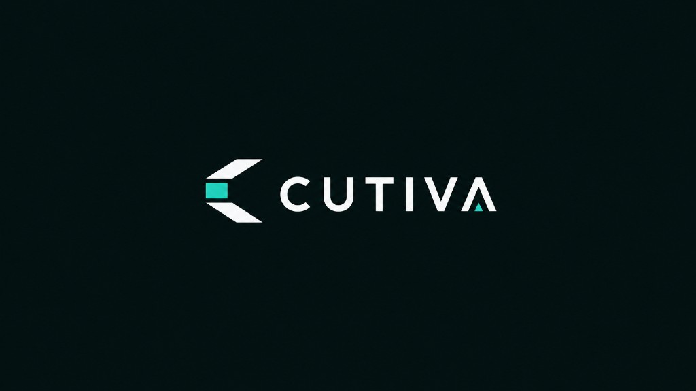

<p align="center">
  
</p>

# CUTIVA — Project Summary and Current Status

**Last updated:** 18 October 2026  
**Product name:** CUTIVA (repo: CuttingOptimizer)  
**Current stage:** Core workshop + cutting optimizer + SaaS layer + **Resources / Products / Costing (V2)** on branch `feature/resources-products-costing`. Migration `AddResourcesProductsAndCosting` exists but is **not applied** until Fadi approves. Feature flags still gate new UI.

## 1. Product idea

CUTIVA helps aluminum workshops:

**projects → openings/sections → stock bars → cutting plans (kerf-aware packing) → approve → client quotes**, with materials, remnants, and accessories.

**New (V2, behind flags):** resources (aluminum / glass / accessories) → product templates → project items → calculate (BOM + optimizer) → detailed cost + quote glass/accessory lines.

See also [`CuttingOptimizer_BRD.md`](CuttingOptimizer_BRD.md) and [`discovery-resources-v2.md`](discovery-resources-v2.md).

## 2. Technology stack

| Technology | Purpose |
|---|---|
| C# / .NET 10 | Backend |
| ASP.NET Core Web API | HTTP API |
| Clean Architecture | Api / Application / Domain / Infrastructure |
| EF Core + PostgreSQL 17 | Persistence (`compose.yaml`) |
| MediatR + FluentValidation | Commands/queries + validation |
| ASP.NET Identity + JWT | Auth and roles |
| Brevo Transactional API | Welcome + password-reset OTP email |
| Angular (`frontend/cutiva-web`) | Workshop app, admin shell, landing (en/ar) |
| Angular PWA (prod SW) | Installable app shell |

## 3. Solution structure

```text
CuttingOptimizer/
├── src/
│   ├── CuttingOptimizer.Api/
│   ├── CuttingOptimizer.Application/
│   ├── CuttingOptimizer.Domain/
│   └── CuttingOptimizer.Infrastructure/
├── tests/
│   ├── CuttingOptimizer.Domain.Tests/
│   └── CuttingOptimizer.Application.Tests/
├── frontend/cutiva-web/
├── scripts/
├── docs/
├── compose.yaml
└── CuttingOptimizer.sln
```

## 4. What works today (core)

- Workshop graph: workshops, projects, sections, sectors, materials, stock bars, required cuts
- **Cutting plans:** generate, alternatives, approve; FFD-style optimizer with kerf and remnants
- Auth: JWT login; roles `Admin` | `WorkshopOwner` | `WorkshopMember`
- Seeded admin: `fadialhallag@gmail.com` / `Admin123!` → `/admin`
- Public signup **disabled** — clients created by admin + Brevo welcome email
- Client quotes + accessories + dashboard remnants

## 5. Resources / Products / Costing (V2)

| Area | Status |
|------|--------|
| Extend Material (`Category`, `ThicknessMm`, `IsActive`) | Code + migration ready |
| GlassType / GlassSpec (workshop-scoped) | API + Resources UI tab |
| Accessory `Brand` / `Unit` | Extended |
| Product templates (Window/Door variants, structured formulas) | Seeded + edit UI |
| ProjectItem + Inspection | Wizard in project workspace |
| `ProjectCostCalculator` + unit tests | Pure service; 8+ tests |
| `POST /api/projects/{id}/calculate` | Generates RequiredCuts with source fields |
| Quote glass/accessory from calculation snapshots | Mapper + quote UI |
| Feature flags `Features:ResourcesV2` / `ProductTemplates` | **Still on** (await OK to remove) |
| Apply migration to DB | **Awaiting Fadi OK** |

Flags: off in base `appsettings.json` + production Angular env; **on** in Development.

## 6. SaaS layer

Admin clients / seats / payment, subscription plans, Brevo, forgot-password, PWA, landing — present on the tree (often still uncommitted alongside V2).

## 7. Domain entities (high level)

Core: `Workshop`, `Project`, `Sector`, `ProjectSection`, `Material`, `StockBar`, `RequiredCut`, `Accessory`, …

V2: `GlassType`, `GlassSpec`, `ProductType`, `ProductVariant`, `TemplatePart`, `TemplateGlassSlot`, `TemplateAccessorySlot`, `ProjectItem`, `ProjectItemInspection`, part/glass/accessory choices

Cutting: `CuttingPlan` (+ bars / pieces / unallocated)

Quotes: `ClientQuote`, `ClientQuoteSurcharge`

SaaS: `SubscriptionPlan`, `WorkshopSubscription`, `PasswordResetOtp`

## 8. Gaps / next

1. Confirm WIP commit split (see discovery doc §1) — **do not commit until Fadi asks**
2. Apply `AddResourcesProductsAndCosting` only after explicit OK
3. Smoke: project → calculate → quote glass lines; old manual cut → plan → approve → quote
4. After workshop validation: remove feature flags (Phase 6 gate)
5. Out of scope: glass 2D nesting, inspection photos, accessory stock qty, online payment

## 9. Local development

```bash
docker compose up -d

ASPNETCORE_ENVIRONMENT=Development ASPNETCORE_URLS=http://localhost:5216 \
  dotnet run --project src/CuttingOptimizer.Api --no-launch-profile

cd frontend/cutiva-web && npm start
```

```bash
dotnet build && dotnet test
cd frontend/cutiva-web && npm run build

dotnet ef migrations list \
  --project src/CuttingOptimizer.Infrastructure \
  --startup-project src/CuttingOptimizer.Api
```

**Dev admin:** `fadialhallag@gmail.com` / `Admin123!`

## 10. Summary

CUTIVA has a working optimizer and workshop shell, plus an additive Resources/Products/Costing path that feeds the same RequiredCut → plan → quote pipeline. Stabilize commits, apply the V2 migration when approved, then validate formulas with real workshop numbers before removing feature flags.
